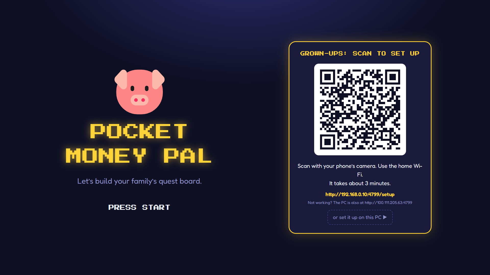
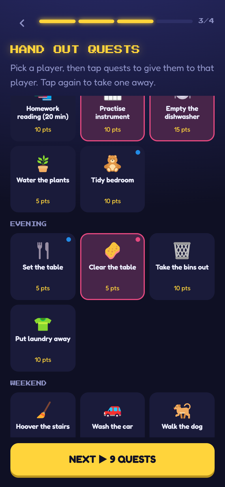
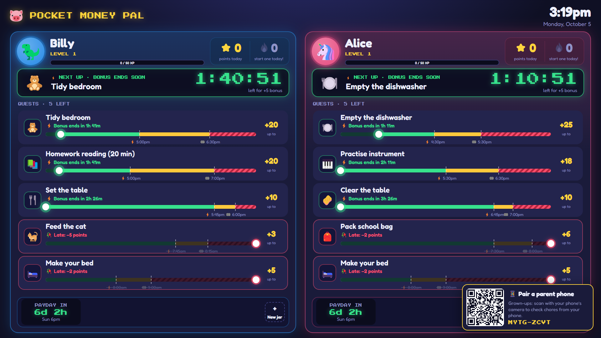

# Installing Pocket Money Pal

This guide takes you from download to a working quest board, with the kids' screen on the family PC and the grown-ups' app on your phones. It takes about 15 minutes, plus a few more to turn on remote access and install the app on your phone.

Once it's running, the [user guide](user-guide.md) explains how to use it day to day.

## What you need

- **A Windows 10 (version 1903 or newer) or Windows 11 PC** that's on whenever the kids are about. It runs the app and keeps the family's data; nothing is stored in the cloud.
- **A screen for the kids.** A second monitor works best, but the PC's only monitor works too. A touch screen is nice; a mouse is fine. The board is laid out for 1920×1080 or bigger.
- **The grown-ups' phones.** They pair on the same Wi-Fi as the PC. With [remote access](#5-remote-access-and-the-phone-app) they work from anywhere after that. Android with Chrome is what we use and test on; iPhones haven't been tried yet.

## 1. Download and install

Pocket Money Pal comes from the Microsoft Store.

1. On the family PC, open [pocketmoneypal.com/download](https://pocketmoneypal.com/download) and click **Download for Windows**. That downloads a small installer from Microsoft, `Pocket Money Pal Installer.exe`. (Or open its [Store page](https://apps.microsoft.com/detail/9N722H5CK1G0), or search for Pocket Money Pal in the Microsoft Store app.)
2. Run it. It installs Pocket Money Pal from the Store, then opens it.

Microsoft signs Store apps, so Windows shows no warning. It also adds the firewall rule that lets phones on your home network reach the PC, without asking.

If your PC can't use the Microsoft Store (some work and school PCs block it), install the `.exe` instead: see [Without the Microsoft Store](#without-the-microsoft-store-the-exe).

When it finishes, Pocket Money Pal starts. A pig icon appears in the system tray (by the clock), and the kids' screen opens full screen.

From now on the app starts when Windows starts. To change that, right-click the tray icon and untick **Start when Windows starts**. Windows has the last word on this for Store apps: if it's been turned off in Task Manager or **Settings > Apps > Startup**, the checkbox opens that Settings page to turn it back on.

## 2. First-run setup

The first time it runs, the kids' screen shows a title screen with a QR code.



Scan the code with your phone's camera (the phone must be on the home Wi-Fi), or click **or set it up on this PC** to do it on the PC. Setup has four short steps:

1. **Game masters:** the grown-ups' names.
2. **Players:** each child's name, age, avatar and colour.
3. **Hand out quests:** pick a child, then tap the chores they should do. The suggestions come with sensible times and points; you can fine-tune them later.
4. **Today's board:** a preview of today, and the **loot rate**: what one point is worth in money (5¢ to start).



Tap **START THE GAME** and the board appears on the kids' screen. If you did setup on your phone, that phone is now paired to the first grown-up. A half-finished setup is saved as you go, so a reload doesn't lose it.

## 3. Choose the kiosk screen

The kids' screen opens on your second monitor if you have one, otherwise on the main one. To move it, right-click the tray icon and pick one under **Kiosk screen**. It moves straight away and stays there after a restart. If that monitor is unplugged, the app goes back to its usual choice.

Other things in the tray menu:

- **Open** brings the kids' screen back if someone closed it. Closing it doesn't stop the app: phones keep working.
- **Restart** restarts the app.
- **Quit** stops it completely, and phones can't connect until it's started again.

While it's running, the app stops the screen from going to sleep.

## 4. Connect parents' phones

Every grown-up action happens on a paired phone: approving chores, editing quests, payday, gifts. The kids' screen has no grown-up mode.

### On the home Wi-Fi

- **The first phone**, if you did setup on the PC: the kids' screen shows a **Pair a parent phone** card with a QR code. Scan it, tap your name, and you're in. The card goes away once a phone is paired.
- **Every other phone:** on a phone that's already paired, go to **Players**, tap **Pair another phone**, and scan the code it shows with the new phone (or type the code in). A code works once, for 10 minutes.



The phone opens an address like `http://192.168.1.20:4789/parent`. Add it to your home screen from the browser menu so it's one tap away.

This works as an ordinary web page, at home only. For the phone app, notifications and use away from home, set up remote access next.

## 5. Remote access and the phone app

Remote access gives the family PC a secure address, like `https://k7qm4pxdhb.pocketmoneypal.app`. With it, each grown-up's phone gets:

- **the app installed** on the phone, with its own icon and no browser bar;
- **notifications** when a child finishes a chore;
- **use from anywhere:** approve chores from work, plan the week from the bus;
- **planning while the PC is off:** changes wait on the phone and are sent when it's back.

It's a one-off purchase: pay once and it's yours for life. Nothing else to install, no router settings, no extra accounts. The family's data stays on your PC (see [How it works](#how-remote-access-works)).

Rather not pay, or like doing it yourself? Everything apart from remote access is free, and you can get the same things with your own set-up: see [Advanced: run it all yourself](#advanced-run-it-all-yourself).

### Buy it

1. Go to [pocketmoneypal.com](https://pocketmoneypal.com#pricing), enter your email and pay.
2. Your key arrives by email within a few minutes, from `hello@pocketmoneypal.com`. It looks like `PMP-XXXXX-XXXXX-XXXXX-XXXXX`. Nothing after 10 minutes? Check your spam folder, or email [support@pocketmoneypal.com](mailto:support@pocketmoneypal.com).

Keep the email: you'll need the key again if you move to a new PC.

### Turn it on

1. On a paired phone, on the home Wi-Fi, open the **Setup** tab and find **🌍 Remote access**.
2. Paste or type the key (spaces, dashes and capitals don't matter) and tap **Connect**.
3. After a few seconds it says **🟢 Connected**.

The PC keeps the connection open by itself from now on, including after restarts. If it drops (the internet goes down, say), it reconnects on its own; the phone shows **🟠 Reconnecting…** in the meantime.

### Move each phone to the app

Each phone that was paired on the Wi-Fi address moves across once. On the phone:

1. Open **Setup** and tap **📲 Use remote access on this phone** (or **Players → 🔒 Move to the app**). If changes made while the PC was off are still waiting, it sends them first.
2. The new address opens. Tap your name under **Who's this phone for?**
3. The **Install the app** screen opens. Tap **📲 Install** (on an iPhone, follow the Share steps it shows). It appears on the home screen as **Money Pal**.
4. Open the installed app. It asks once whether to notify this phone: tap **Yes, notify this phone** and allow notifications.
5. Remove the old home-screen shortcut, if you made one. It now shows "Pair this phone" and isn't needed.

New phones need none of this: **Players → Pair another phone** gives a code that leads straight to the secure address, from anywhere.

### Good to know

- No notifications are sent during **quiet hours** (8pm to 7am unless you change them on the Setup tab). Several chores finished within two minutes arrive as one notification.
- **The PC has to be on and online** for phones to reach it. When it's off, the app says "Family PC is off". You can still plan quests and they're sent later; approvals wait.
- **If the home internet is down**, phones can't reach the PC through remote access, even at home. A phone on the Wi-Fi can still open the PC's own address (`http://<pc-address>:4789/parent`) in a browser; it's paired separately.
- **Turning it off:** Setup → Remote access → **Disconnect**. Phones on the secure address stop working until you connect again. The key stays yours, and connecting again gives the same address.
- **A new PC, or after a factory reset:** restore your backup (see [Backup and restore](#backup-and-restore)), then enter the same key. It says the key is in use on another PC: tap **Move it**. The address stays the same, so phones carry on as before, notifications included.
- **iPhones** haven't been tried yet. **Samsung phones** don't list the installed app in Settings > Apps; Chrome lists it at `chrome://webapks`.

### How remote access works

The PC opens a connection out to Pocket Money Pal's service and keeps it open. When a phone uses the secure address, its messages pass along that connection to the PC and back. The PC stores everything and makes every decision; the service only forwards. It runs on Cloudflare, and the connection is encrypted between the phone and Cloudflare and between Cloudflare and the PC, but not end to end: messages are readable by the service as they pass through. It keeps no copy of them and logs none. It keeps your email, your purchase and which PC your key is connected to.

Remote access only lets in phones you've paired. Pairing still needs a one-time code from a phone that's already paired or the kids' screen, and too many wrong tries are blocked.

## Backup and restore

Backups are made from a paired phone, under **DATA** on the Setup tab.

**To back up:** tap **💾 Download backup**. The phone saves one file, `pocket-money-pal-<date>.pmpbackup`, holding everything: players, quests, points, jars and their pictures, paydays and paired phones. Keep it somewhere private, such as your own cloud storage. It holds the keys that send notifications to your phones.

**To restore:**

- **Over the current data:** tap **📦 Restore from a backup**, pick the file, check what's in it, and type `RESTORE`. Anything since the backup was saved is lost.
- **After a factory reset, or on a new PC:** on the first setup screen, tap **📦 Restore from a backup** instead of START.

Phones that were paired when the backup was made are paired again straight away. A phone the backup doesn't know asks which grown-up you are.

A backup from a newer version of the app can only be restored once the PC is updated. Older backups are fine.

There's also a **Factory reset** under **DANGER ZONE** on the same tab, for starting again from scratch. It can't be undone, so download a backup first if you might want the old data back.

**By hand:** everything also lives in one folder, `%LOCALAPPDATA%\Packages\ChrisHammond-Ross.PocketMoneyPal_261vw71rvrwvr\LocalCache\Roaming\Pocket Money Pal (Store)` (the `.exe` version uses `%APPDATA%\Pocket Money Pal`). With the app quit (tray icon > **Quit**), copying `pmp.db` (with `pmp.db-wal` and `pmp.db-shm` if they're there) and the `images` folder is a backup too.

## Updating

The Microsoft Store keeps Pocket Money Pal up to date, like your other Store apps. Phones and the kids' screen pick up the new version by themselves.

The version you're running is shown at the bottom of the phone's **Players** tab.

## Uninstalling

**Uninstalling deletes the family's data.** Download a backup on a phone first (see [Backup and restore](#backup-and-restore)).

Go to **Settings > Apps**, find **Pocket Money Pal**, and choose **Uninstall**. Windows removes the firewall rule with it.

Your remote access key stays yours: enter it on the next PC and choose **Move it**. If you set up Tailscale yourself, run `tailscale serve --https=443 off` to stop serving the address, or uninstall Tailscale itself.

## Without the Microsoft Store (the `.exe`)

For PCs where the Microsoft Store is blocked, Pocket Money Pal also comes as an ordinary installer. It's the same app.

1. On [pocketmoneypal.com/download](https://pocketmoneypal.com/download), click **Can't use the Microsoft Store? Get the .exe instead**, then **Download the .exe**. (It's also on the [Releases page](https://github.com/chris-hammond-ross/pocket-money-pal/releases) as `Pocket-Money-Pal-Setup-<version>.exe`.)
2. Run it. Windows will probably show a blue **"Windows protected your PC"** box. That's SmartScreen: it warns about any program that hasn't been signed with a paid certificate, and this one isn't. Click **More info**, then **Run anyway**.
3. Go through the installer. The defaults are fine. It installs for your Windows user only, so it never needs admin rights to update itself.
4. Near the end, a message says Windows will ask about **Network Command Shell**. Choose **Yes** when it does. That adds a firewall rule so phones on your home network can reach the PC. It's the only time the app asks for admin rights. If you choose No, phones won't be able to connect; run the installer again to get the question back.

Then carry on from [First-run setup](#2-first-run-setup). A few things work differently from the Store version:

- **It updates itself.** The app checks for a new version every few hours and downloads it in the background. It installs at about 3am, or straight away if the PC has only just started. To install a downloaded update now, choose **Restart to update** in the tray menu.
- **Its data lives in** `%APPDATA%\Pocket Money Pal`, and **uninstalling keeps it**, in case you reinstall. Delete that folder to remove everything. Uninstalling asks once more for permission, to remove the firewall rule.

**Moving from the `.exe` to the Store version:**

1. On a phone, download a backup (see [Backup and restore](#backup-and-restore)).
2. Quit the `.exe` version (tray icon > **Quit**). Only one copy can run at a time.
3. Install Pocket Money Pal from the Store (see [Download and install](#1-download-and-install)) and open it.
4. On the first setup screen, tap **📦 Restore from a backup** and pick the file. Phones paired before keep working.
5. Uninstall the `.exe` version from **Settings > Apps**. Its old folder stays in `%APPDATA%` until you delete it.

Moving the other way works the same, but download the backup before uninstalling the Store version, because that deletes its data.

## Advanced: run it all yourself

Remote access is the easy way to get the phone app. Everything else in Pocket Money Pal is free, and if you're comfortable with networking you can do without remote access entirely. There are three ways.

**Requests through any proxy are treated as coming from outside.** Whatever carries a phone's request to the PC (Tailscale, `cloudflared`, a reverse proxy), the PC treats it exactly like remote access: only paired phones get in, every change must come from the app's own page, and pairing and setup are rate-limited. Paired phones notice no difference.

### Home network only

Nothing to set up: pair phones as in [Connect parents' phones](#4-connect-parents-phones) and add the page to the home screen. Without a secure (HTTPS) address, phones won't install the app, give notifications or plan while the PC is off, and they only work on the home Wi-Fi.

### Tailscale

[Tailscale](https://tailscale.com) gives the PC a free HTTPS address, reachable only by your own devices, at home or away. Each phone needs the Tailscale app, signed in to the same account. These are the steps we used on Windows 11 and an Android phone with Chrome.

1. **Install Tailscale on the PC** from [tailscale.com/download/windows](https://tailscale.com/download/windows). If the installer ends with a long "Unable to set up Tailscale client" message about `Shell_NotifyIcon`, click OK: only its tray icon failed to start, and Tailscale itself is running.
2. **Sign in.** Open Tailscale from the Start menu and log in with the account that will own your private network (Google, Microsoft, GitHub and others work).
3. **Turn on HTTPS.** In the Tailscale admin console, open [DNS](https://login.tailscale.com/admin/dns), check **MagicDNS** is on, and click **Enable HTTPS** under HTTPS Certificates. The **Machines** page shows the PC's name; you can rename it there, for example to `family-pc`.
4. **Point Tailscale at Pocket Money Pal.** With Pocket Money Pal running, open PowerShell and run:

   ```powershell
   & "C:\Program Files\Tailscale\tailscale.exe" serve --bg 4789
   ```

   It prints the PC's secure address, something like `https://family-pc.tail1234.ts.net`, and keeps serving it after restarts. Open `https://family-pc.tail1234.ts.net/kiosk` on the PC once: that fetches the certificate (it can take a few seconds) and tells Pocket Money Pal its secure address.

5. **Install Tailscale on each grown-up's phone** from the Play Store, sign in with the **same account**, and leave it connected. It only carries traffic for your own devices, so the rest of the phone's internet is unaffected.
6. **Move each phone across.** On a paired phone, go to **Players** and tap **🔒 Switch to secure app**. It opens the secure address with a one-time code; tap your name.
7. **Install the app and turn on notifications,** as in steps 3 and 4 of [Move each phone to the app](#move-each-phone-to-the-app).

Pairing codes still lead to the Wi-Fi address, so a new phone pairs on the home Wi-Fi first, then switches.

### Your own domain, with `cloudflared` or a reverse proxy

You can put the PC behind your own HTTPS address, such as `https://pmp.example.com`, with a [Cloudflare Tunnel](https://developers.cloudflare.com/cloudflare-one/connections/connect-networks/) (`cloudflared`) or a reverse proxy such as Caddy or nginx. Whatever you use must:

- **run on the family PC itself** and connect to `http://127.0.0.1:4789`. A proxy on another machine (a NAS, a router, a Raspberry Pi) makes every request look as if it came from inside your home, which would let anyone on the internet use the kids' screen without pairing. Don't do that;
- **send `X-Forwarded-For`** with the phone's address, and `X-Forwarded-Proto: https`;
- **keep the public name** in `Host` (or send it as `X-Forwarded-Host`), or the app refuses every change with `bad-origin`;
- **pass WebSockets** on `/ws`;
- **allow uploads up to 100 MB**, for restoring a backup from a phone.

`cloudflared` and Caddy do all of this with their defaults. With `cloudflared`, the ingress rule is:

```yaml
ingress:
  - hostname: pmp.example.com
    service: http://127.0.0.1:4789
  - service: http_status:404
```

With Caddy:

```text
pmp.example.com {
	reverse_proxy 127.0.0.1:4789
}
```

nginx needs it spelled out:

```nginx
location / {
    proxy_pass http://127.0.0.1:4789;
    proxy_http_version 1.1;
    proxy_set_header Host $host;
    proxy_set_header X-Forwarded-For $remote_addr;
    proxy_set_header X-Forwarded-Proto https;
    proxy_set_header Upgrade $http_upgrade;
    proxy_set_header Connection $connection_upgrade;
    client_max_body_size 100m;
}
```

(`$connection_upgrade` comes from the usual `map $http_upgrade $connection_upgrade { default upgrade; '' close; }` in the `http` block.)

Then, to start using it:

1. On a phone that's already paired, open **Players → Pair another phone** to get a code.
2. On the phone you want on the new address, open `https://pmp.example.com/parent`, type the code and tap your name. That phone now uses the secure address, and the PC remembers it.
3. Install the app and turn on notifications, as in [Move each phone to the app](#move-each-phone-to-the-app). Other phones can now use **Players → 🔒 Switch to secure app**.

## Troubleshooting

- **A phone can't connect** (the page loads forever): check the phone is on the same Wi-Fi as the PC, and not a guest network, which routers usually keep apart. On the phone, open `http://<pc-address>:4789/api/health`; it should show `"ok":true`. If it doesn't, the firewall rule may be missing. With the `.exe` version, run the installer again and choose Yes to the Network Command Shell question.
- **Remote access says "That key isn't right"**: check it against your purchase email, or copy and paste it from there. Still wrong? Email [support@pocketmoneypal.com](mailto:support@pocketmoneypal.com) from the address you bought with.
- **"Can't reach Pocket Money Pal's remote access service"**: the PC isn't online, or something on it (a firewall, antivirus or work network) blocks outgoing connections to `pocketmoneypal.app`. Check the PC's internet connection and try again.
- **"Remote access moved to another PC"**: the same key was entered on another PC, which now has remote access. To bring it back to this PC, enter the key again and tap **Move it**.
- **The installed app says "Family PC is off"** while the PC is on: check the PC is online, and that Setup → Remote access says **🟢 Connected** (from a phone on the home Wi-Fi, if needed). Restarting the app from the tray reconnects it.
- **"Pocket Money Pal could not start"** or **"The server stopped unexpectedly"**: another copy is probably running, perhaps both the Store and `.exe` versions. Quit it from the tray and try again.
- **The kids' screen is on the wrong monitor:** see [Choose the kiosk screen](#3-choose-the-kiosk-screen).
- **The phone says "Open this in Chrome to install":** the phone's browser (DuckDuckGo, or an app's built-in browser such as Facebook's or Gmail's) can't install apps. Tap **Open in Chrome**, or **Copy the link** and paste it into Chrome within 10 minutes. The phone stays paired as the same grown-up. On an iPhone, paste it into Safari. To stay in that browser without installing, tap **Keep using this tab**.
- **Every phone is lost, or a phone was paired in the wrong browser:** right-click the Pocket Money Pal icon in the system tray (by the clock), choose **Unpair all phones…**, and confirm. Every paired phone stops working with the app; quests, points and money stay as they are. The kids' screen then shows a **Pair a parent phone** QR code. Scan it with the phone's camera, open it in Chrome (Safari on an iPhone), and pick who the phone is for. Pair the other grown-ups' phones from that one (**Players → Pair another phone**). Running from source: `npm run devices:reset -w @pmp/server` does the same.
- **Something else:** the app writes a log, `desktop.log`, in its data folder (see [Backup and restore](#backup-and-restore) for where that is). Please include it if you [open an issue](https://github.com/chris-hammond-ross/pocket-money-pal/issues).

## Running from source

For developers. You need Windows 10 or 11 (the server also runs on macOS and Linux, but the kiosk app and installer are only tested on Windows), [Node.js](https://nodejs.org) 22 or newer, and Git.

```bash
git clone https://github.com/chris-hammond-ross/pocket-money-pal.git
cd pocket-money-pal
npm install

npm run dev            # server on :4789 and Vite on :5173, with hot reload
npm run build          # build everything, then:
npm start              # serve it all on http://localhost:4789
npm run desktop:dev    # build and open the kiosk window (Electron)
npm run desktop:dist   # build the Windows installer into apps/desktop/release/
npm run desktop:store  # build the Microsoft Store package (.appx, unsigned) into apps/desktop/release/
```

In development, open http://localhost:5173/kiosk on the PC and `http://<pc-address>:5173/parent` on a phone. Phones need a firewall rule for the port; in PowerShell as administrator:

```powershell
netsh advfirewall firewall add rule name="Pocket Money Pal" dir=in action=allow protocol=TCP localport=4789 profile=any remoteip=localsubnet
```

Use `localport=5173` too for `npm run dev`. Use `profile=any`, not a Private-only rule: on a PC with VirtualBox, Hyper-V or VPN adapters, Windows can judge the home network as Public, and phones then time out with nothing in the firewall log.

**Data:** `npm start` and `npm run dev` use `apps/server/data/pmp.db`; the kiosk app (dev or the installed `.exe`) uses `%APPDATA%\Pocket Money Pal\pmp.db`, and the Store version its own folder (see [Backup and restore](#backup-and-restore)). Migrations run when the server starts.

**Settings** are environment variables, none of them required:

| Variable            | Default                           | What it does                                                                                                                   |
| ------------------- | --------------------------------- | ------------------------------------------------------------------------------------------------------------------------------ |
| `PMP_PORT`          | `4789`                            | Port the server listens on.                                                                                                    |
| `PMP_HOST`          | `0.0.0.0`                         | Address to listen on. `127.0.0.1` keeps it off the network.                                                                    |
| `PMP_DB_PATH`       | see above                         | Path of the database file.                                                                                                     |
| `PMP_LOG_LEVEL`     | `info`                            | Server log level.                                                                                                              |
| `PMP_PUBLIC_URL`    | guessed LAN address               | Address phones use in the setup QR code, if the guess picks the wrong network adapter.                                         |
| `PMP_SECURE_URL`    | learned                           | Your own HTTPS address for "Switch to secure app", if you'd rather not let it be learned. Remote access, when on, comes first. |
| `PMP_RELAY_URL`     | `https://pocketmoneypal.app`      | The remote access service. Point it at a staging or local relay when developing.                                               |
| `PMP_VAPID_SUBJECT` | `mailto:pocketmoneypal@localhost` | Contact address push services see with notifications.                                                                          |
| `PMP_DISPLAY`       | the tray's choice                 | Kiosk app only: the monitor index (`0`, `1`, …). Overrides the tray's Kiosk screen menu.                                       |
| `PMP_KIOSK`         | off                               | Kiosk app only: `1` locks the window in kiosk mode.                                                                            |
| `PMP_SERVER_URL`    | bundled server                    | Kiosk app only: use an already-running server, e.g. `http://localhost:5173`.                                                   |

When running the installed exe from a VS Code terminal, clear `ELECTRON_RUN_AS_NODE` first, or it silently does nothing.

**Publishing a release:** push a version tag (`git tag v0.2.0 && git push origin v0.2.0`). The Release workflow sets every package's version from the tag, runs the checks, builds the installer and the Store package, and publishes both on GitHub. Installed `.exe` copies update themselves within a few hours. The `.appx` goes up to Partner Center by hand (ADR 0027), and Store copies update once Microsoft has certified it.
